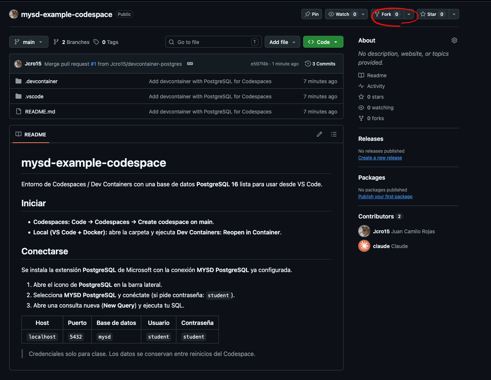
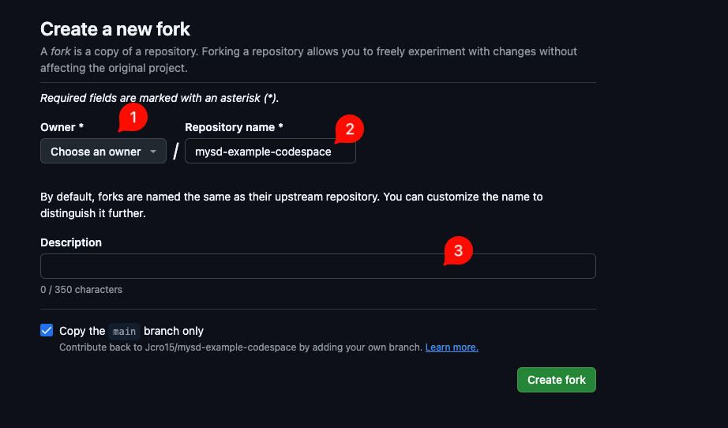
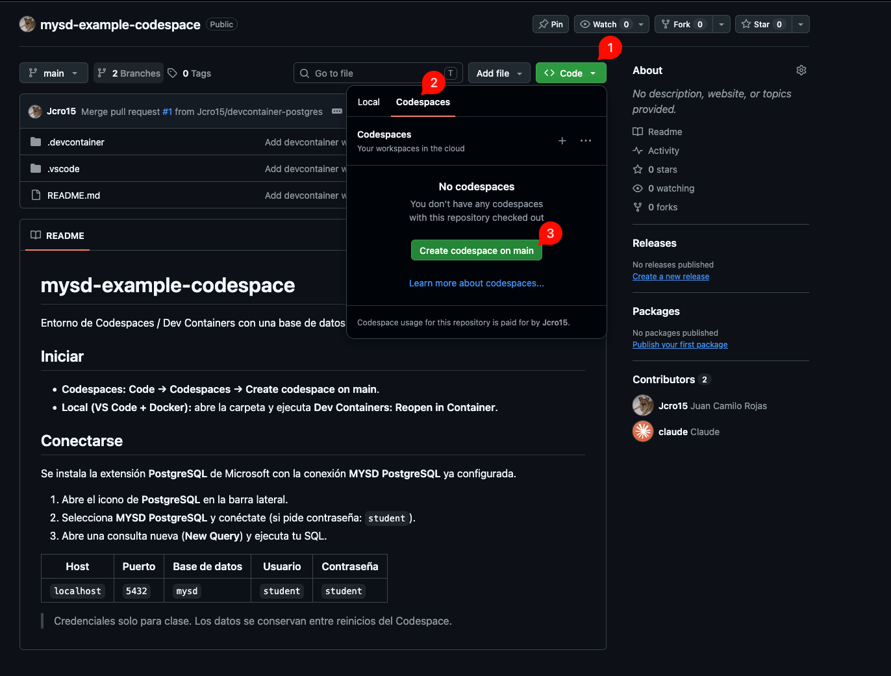

# mysd-example-codespace

Entorno de GitHub Codespaces con una base de datos **PostgreSQL 16** lista para usar desde VS Code.

## 1. Haz un fork del repositorio

No crees el Codespace sobre este repositorio: primero haz tu propia copia (fork) y trabaja siempre sobre ella.

1. Haz clic en **Fork** (arriba a la derecha).

   

2. En el formulario:
   1. **Owner:** selecciona tu usuario de GitHub.
   2. **Repository name:** deja el nombre o cámbialo si quieres.
   3. **Description:** opcional.

   Luego haz clic en **Create fork**.

   

## 2. Crea el Codespace en tu fork

Verifica que estás en **tu** repositorio (`tu-usuario/nombre-proyecto`) y no en el original.

1. Haz clic en **Code**.
2. Abre la pestaña **Codespaces**.
3. Haz clic en **Create codespace on main**.

La primera vez tarda unos minutos mientras se crean los contenedores.

## 3. Conéctate a la base de datos

Se instala la extensión **PostgreSQL** de Microsoft con la conexión **MYSD PostgreSQL** ya configurada.

1. Abre el icono de **PostgreSQL** en la barra lateral.
2. Selecciona **MYSD PostgreSQL** y conéctate (si pide contraseña: `student`).
3. Abre una consulta nueva (**New Query**) y ejecuta tu SQL.

| Host | Puerto | Base de datos | Usuario | Contraseña |
|------|--------|---------------|---------|------------|
| `localhost` | `5432` | `mysd` | `student` | `student` |

> Credenciales solo para clase. Los datos se conservan mientras no elimines el Codespace.
